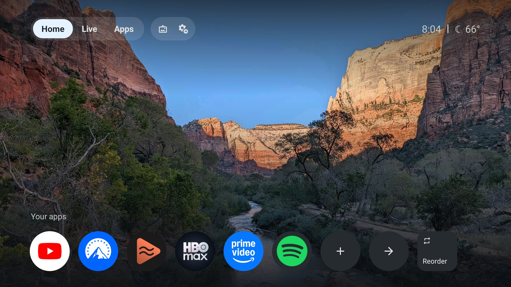
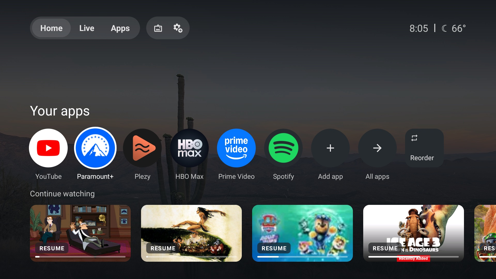
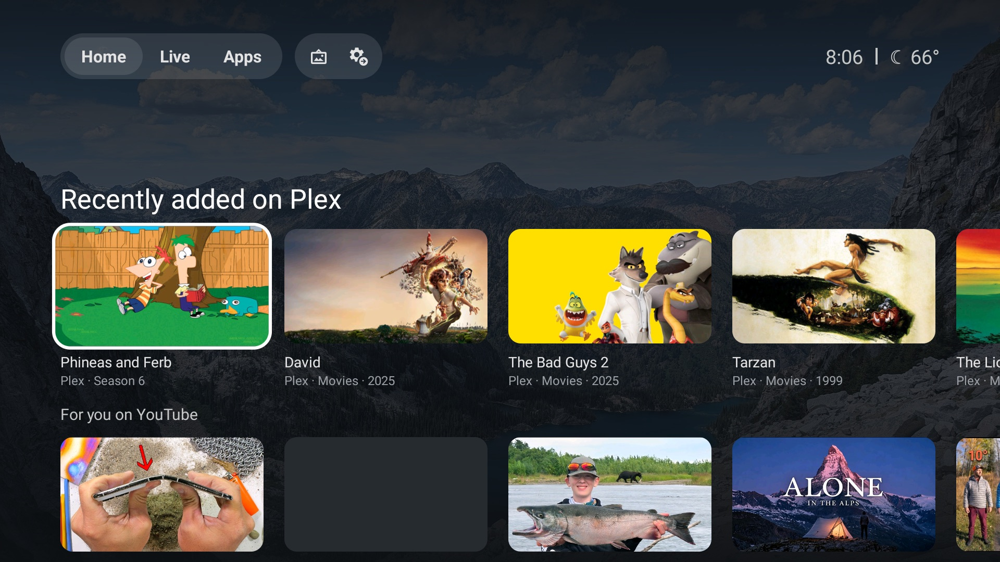

# TCL GTV Launcher

A Google TV–style home screen for TCL Google TVs, without the ads and sponsored rows, plus a script that
debloats the TV and installs it.

**Tested on:** TCL G03_4K_US (Android 11, build GTV93) and TCL Smart TV (Android 12, build AS50).



| Continue watching | Recently added on Plex |
|---|---|
|  |  |

## What you get

- **Top bar:** Home / Live / Apps tabs, a screensaver button that starts Google's own screensaver, quick
  settings, the time and the weather.
- **Background:** photos from a Google Photos shared album, refreshed every hour.
- **Your apps:** round icons you can add, remove and reorder (hold OK, or use Reorder, as on Google TV).
- **Continue watching:** from Netflix, HBO Max, Disney+, Paramount+ and the other apps that publish to
  Android TV's Watch Next. YouTube doesn't publish there, so YouTube gets its own rows instead.
- **Recently added on Plex:** movies and shows from your own server. Selecting one plays it in
  [Plezy](https://github.com/edde746/plezy), since the Plex app can't open a server item from a link.
- **Live:** goes straight to the antenna. **Apps:** every app, in a grid; hold OK to uninstall.

The debloat list in `kit/debloat.txt` disables TCL's telemetry, promos and preloaded extras, plus a
few apps by choice (batch 4: TCL Channel, TCL+, YouTube Music, TCL Media Center, Alexa, TCL's assistant).
**Read it first** and delete any line for something you want to keep. Everything is disabled, never
uninstalled, so it can all be undone.

## Before you start

On the Mac or PC:
- Git, Python 3, `curl`
- JDK 17 and the Android SDK (platform 34). Android Studio installs both; set `ANDROID_HOME` or put
  `sdk.dir=...` in `launcher/local.properties`.

```
git clone --recurse-submodules https://github.com/alexkev/tcl-gtv-launcher
```

On the TV:
1. Settings > System > About: press OK on **Android TV OS build** 7 times.
2. Settings > System > Developer options: turn on **USB debugging** (and **Network debugging** if listed).
3. Note the TV's IP address (Settings > Network & Internet).

## Run it

```
kit/setup.sh <tv ip> [google photos shared-album link]
```

Accept the "Allow debugging" prompt on the TV. The album link comes from Google Photos: Album > Share >
Create link. Leave it out for a plain dark background.

The script:
1. Backs up the TV's package list and settings to `backup/<tv ip>/`.
2. Disables the packages in `kit/debloat.txt`, using
   [cleanyourtv](https://github.com/Gathin23/cleanyourtv)'s `disable.sh`, which refuses to touch anything the
   TV needs. That repo is a submodule here, and it provides the ADB tools too.
3. Turns on AdGuard's ad-blocking Private DNS.
4. Builds and installs the launcher, then downloads Plezy 2.24.0 from its GitHub release, checks its
   SHA-256 and installs it.
5. Makes the launcher Home, then disables Google TV's launcher. If Home doesn't move, it puts everything back.
6. Reboots and confirms. Screenshots go to `shots/`.

## After the script

- **Plezy:** open it and sign in to Plex.
- **Plex row:** on Home, select "Link your Plex server" and enter the code at plex.tv/link.
- **Your apps:** add your apps with `+`; hold OK on one to move or remove it.
- **Weather:** found from your IP address. Set `weather_city` in `launcher/app/src/main/res/values/config.xml`
  to pick a city, then run the script again.
- **Real remote:** check Home, Live, the screensaver and quick settings.
- **Close ADB when done:** in Developer options, turn off USB and Network debugging and revoke USB
  debugging authorisations, then reboot the TV. Check with
  `cleanyourtv/tools/venv/bin/python cleanyourtv/tools/adb-closed.py <tv ip>`.

To update the launcher later, run the script again: it's safe to repeat, and keeps the first backup.

## Undo

```
TV_HOST=<tv ip> cleanyourtv/tools/restore.sh kit/home.txt      # Google TV's home screen back
TV_HOST=<tv ip> cleanyourtv/tools/restore.sh kit/debloat.txt   # everything else
TV_HOST=<tv ip> cleanyourtv/tools/venv/bin/python cleanyourtv/tools/tv.py "settings put global private_dns_mode opportunistic"
```

## Notes

- **Signing:** the launcher is signed with each computer's own Android debug key. A TV set up from one
  computer won't accept an update built on another; uninstall the launcher first (`pm uninstall
  tv.cleanhome.gtv`, after `restore.sh kit/home.txt`).
- **Plex tokens:** they stay on the TV, in the launcher's private storage. Nothing personal is in this repo.
- **`kit/push.py`:** cleanyourtv's `b64push.py`, decoding each chunk as it goes, because the 92 MB Plezy
  APK timed out otherwise.

## Network

No ads, analytics or telemetry. The launcher contacts only:
- **Weather:** ipapi.co for the approximate location (skipped when `weather_city` is set) and Open-Meteo.
- **Background:** your Google Photos shared-album page and its images, when you give an album link.
- **Plex:** plex.tv to link your account and find your server, then your own server. Show cards look up
  the next episode there; without Plezy, links go through discover.provider.plex.tv and watch.plex.tv.
- **Posters:** the thumbnail images that your apps publish with their Continue watching and YouTube rows.

## Licence

MIT, see [LICENSE](LICENSE). `kit/push.py` is adapted from cleanyourtv's `tools/b64push.py` (MIT,
copyright Gathin). Plezy is downloaded from its own releases and isn't part of this repo.
